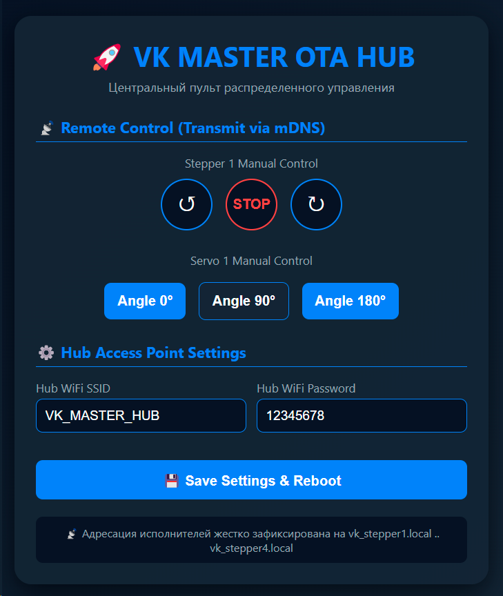
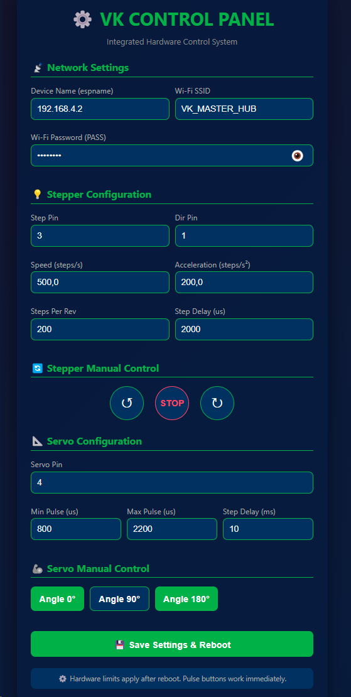

# ⚙️ VK_MasterSlave: Распределенное управление двигателями по Wi-Fi (ESP32 + ESP32-C3)

Пример архитектуры распределенной системы для беспроводного контроля и управления исполнительными механизмами. Проект демонстрирует организацию сети, где центральный пульт (**Master Hub на базе ESP-32S**) создает локальную Wi-Fi точку доступа, а удаленные модули (**Slave Nodes на базе ESP32-C3-SuperMini**) подключаются к ней и выполняют команды веб-интерфейса.

---

## 📸 Веб-интерфейс системы

| Панель управления Master Hub | Панель настройки исполнителя Slave Node |
| :---: | :---: |
|  |  |

---

## 🚀 Ключевые технические особенности

- **Полная асинхронность (Non-blocking):** Все алгоритмы управления механикой (генерация импульсов шагового двигателя для A4988 и плавный поградусный ход сервоприводов) реализованы на неблокирующих таймерах `millis()` / `micros()`. Цикл `loop()` полностью разгружен, что исключает сетевые задержки встроенного веб-сервера.
- **Прямая IP-адресация (Zero-mDNS):** Для обеспечения максимальной отзывчивости и исключения скрытых фризов сетевого стека, mDNS полностью отключен. Подчиненные модули запрашивают жестко фиксированные статические IP-адреса, прописанные в их энергонезависимой памяти.
- **REST API Перенаправление (HTTP Forwarding):** Веб-страница Мастера взаимодействует с пользователем через AJAX/Fetch запросы. Хаб принимает эти запросы и прозрачно транслирует HTTP GET команды на целевые IP-адреса исполнительных плат за доли миллисекунд.
- **Локальная конфигурация (LittleFS):** Настройки сети и параметры моторов (пины, рабочие скорости, задержки ШИМ-импульсов) хранятся в файлах `config.txt` на Flash-памяти устройств и могут изменяться индивидуально через веб-интерфейс без перепрошивки микроконтроллеров.

---

## 📁 Структура монорепозитория и возможности веб-панелей

- `/VK_ESP32S_center` — **Центральный пульт (Master Hub)** на ESP-32S. Поднимает защищенную Wi-Fi сеть `VK_MASTER_HUB`, отслеживает динамическое подключение IP-адресов клиентов в реальном времени, транслирует команды управления и отвечает за светодиодную индикацию готовности сети.
  * *Функционал веб-интерфейса:* Позволяет администратору гибко **изменять название и пароль создаваемой точки доступа** прямо из браузера.
- `/VK_ESP32C3supermini` — **Исполнительный модуль (Slave Node)** на ESP32-C3-SuperMini. Принимает REST-команды от Хаба, генерирует управляющие импульсы для шагового драйвера A4988 и контролирует сервопривод через аппаратный ШИМ (`LEDC` API версии 3.x).
  * *Функционал веб-интерфейса:* Предоставляет панель для оперативного **изменения физических параметров двигателя** (шаг, направление, скорость вращения, длительность импульса, пины подключения), с возможностью их автоматического **сохранения в конфигурационных файлах во флеш-памяти** платы.

---

## ⚡ Требования к аппаратному питанию

> **ВНИМАНИЕ:** Одновременная работа Wi-Fi радиомодуля и пусковых токов электродвигателей (пики более 2А при старте силовых сервоприводов) требует обязательного разделения линий питания.
> 
> Силовая часть драйверов шаговых моторов (`VMOT`) и линии питания сервоприводов `+5V / +6V` должны быть подключены к мощным внешним источникам или ЛБП. Минусовые провода (**GND**) всех источников питания и плат ESP32 должны быть надежно объединены в одной точке.

---
*Проект разработан, отлажен и скомпилирован в среде Visual Studio Code с использованием расширения PlatformIO IDE под управлением Arduino Framework.*
